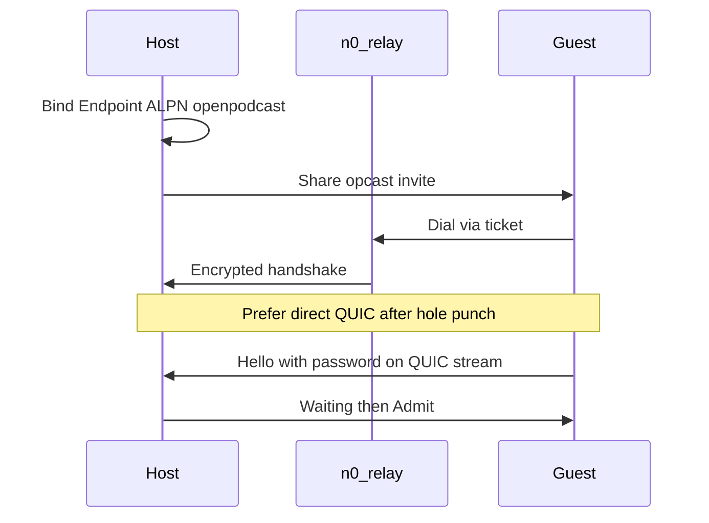

# Cross-network studios via iroh

## Why invites fail today

[`src-tauri/src/p2p.rs`](src-tauri/src/p2p.rs) dials raw TCP to IPs embedded in the invite. A ticket like `10.30.70.197` is private LAN/VPN only. That cannot work across countries. Advertising a public IP alone also fails for most home/CGNAT networks without port forwarding.

## Chosen approach

Use **iroh**, as in the original OpenPodcast architecture: each app opens an `Endpoint`, hole-punches when possible, and falls back to **n0 public relays** (they only forward encrypted packets; you do not host them). The invite stays a pasteable `opcast_…` string, but dialing info becomes an iroh endpoint ticket instead of IP:port.

## Invite format (v2)

Keep the `opcast_` prefix. Payload fields:

- `version: 2`
- `iroh_ticket`: iroh endpoint ticket (node id + relay URL + addresses)
- `password`, `studio`, `host_name`, `created_at` (same semantics as today)

Reject v1 TCP tickets with a clear message that both apps must be updated.

Update [`InviteTicket`](src-tauri/src/models.rs) and [`src/types.ts`](src/types.ts).

## Rust core changes

**Dependencies** in [`src-tauri/Cargo.toml`](src-tauri/Cargo.toml): add current `iroh` (pin a recent 0.9x that builds cleanly).

**Rewrite** [`src-tauri/src/p2p.rs`](src-tauri/src/p2p.rs):

- `StudioHost::start`: build/bind `Endpoint` with ALPN `openpodcast/1`, spawn accept loop; for each connection, use a bidirectional QUIC stream and keep the existing length-prefixed JSON `PeerMessage` framing.
- `encode_ticket` / `get_invite`: build v2 ticket from endpoint address/ticket helpers + password + studio settings.
- `join_studio`: parse v2, `endpoint.connect(..., ALPN)`, send Hello; ~20s timeout with a readable error if host offline or blocked.
- `send_file` / track return: same chunk protocol over the iroh stream (call sites in [`lib.rs`](src-tauri/src/lib.rs)).
- Stop using `host_addrs`/`port` for dialing. Same-LAN still works via iroh direct path.

**AppState**: `StudioHost` owns the `Endpoint`, accept task, and peer map (admit UX unchanged).

**Lobby boot**: endpoint bind must stay off the critical UI path (frontend already shows lobby while studio creates in background).

## UI

- Invite copy/paste flow unchanged.
- Optional one-line hint: works across networks; both people must be online.
- Join failures must show connect timeout / wrong password / host offline clearly.

## Out of scope

- Running your own relay or TURN
- Guest-to-guest mesh (keep star: guest to host)
- Record/Drive pipeline changes

## Verification

1. Same Wi-Fi: join + admit still works.
2. Different networks (phone hotspot vs home Wi-Fi): guest connects within about 20s.
3. After stop, guest track return still completes.
4. Old v1 `opcast_` tickets show an upgrade error.
