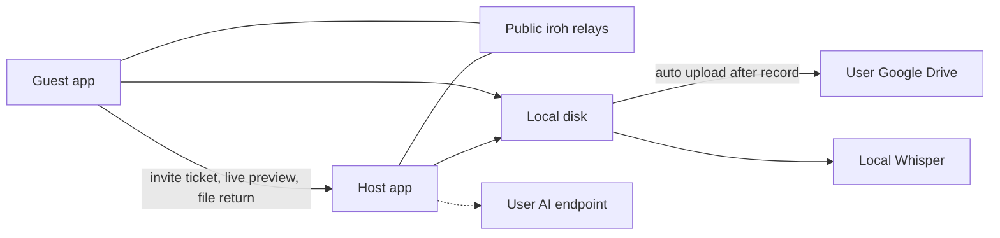

# Local podcast studio

A downloadable desktop app (working name OpenPodcast) for the empty repo at [openpodcast](/Users/shivankarsharma/code/openpodcast). No website, no account system, and no machine you pay to keep online. **Tauri 2** is the shell.

## What Riverside actually does, and what v1 copies

Riverside is a recorder, not a Zoom clone. Each person is captured on their own computer, then those files are aligned. The internet only carries a watchable preview. That is the part worth copying.

v1 matches that core:

- Host creates a studio (lobby) with a mode and quality settings, then shares an invite. Guests install the same Mac/Windows app and paste the invite. Up to 3 guests (4 people).
- Lobby: camera/mic check (camera only when the studio is audio+video), host admits guests from a waiting list.
- Live studio: gallery of people, mute, camera on/off (video mode), red record button, timer. **UI/UX should read as Riverside** — same screen flow, chrome, and interaction patterns (see dedicated section below). Screenshots from you are welcome to tighten spacing, type, and labels.
- **Studio modes (host chooses when creating the lobby):**
  - **Audio only** — each person records 48 kHz 16-bit WAV. Live preview is audio + name/avatar, no camera stream.
  - **Audio + video** — each person records CFR H.264 MP4 (default 1080p) plus a matching WAV. Live preview includes a low-res video thumbnail.
- **Frame rate (host chooses, video mode):** 24, 25, 30 (default), or 60 fps. Locked for the whole session so every track matches. Constant frame rate encoding so editors stay in sync.
- Quality does not depend on the call. Host clock is the master. A short ping measures delay, and finished tracks get start padding so they line up (Riverside’s “aligned” tracks).
- After stop, each guest sends their files to the host. The host’s library is the episode.
- **Google Drive is primary storage:** every install can Connect Google Drive. When recording finishes (and guest→host transfer completes on the host), the app **automatically uploads** that machine’s finished tracks to the user’s Drive. Host gets the full session set; each guest can also keep/upload their own local track.
- After tracks land, open the **Riverside-style editor** (screenshot reference below): preview canvas, speaker timeline, captions, tracks, export/share to Drive.
- Subtitles from those separate tracks, so each speaker is already known. Captions panel + SRT export.
- Optional show notes through whatever AI the user connects.

Left for later (UI may show disabled/stub entries so the chrome still matches): Magic Clips / full AI co-editor, real-time collab cursors on the timeline, stock media library, music bed library, brand kit, teleprompter, screen share as its own track, media board, 4K, phone apps, livestreaming, Premiere/Final Cut project export.

## Architecture that costs nothing to run



- **Shell:** [Tauri 2](https://v2.tauri.app/) with a Rust core and a React + Vite UI. One codebase, native `.dmg` and Windows installer. Far smaller than Electron. UI talks to Rust only through Tauri commands.
- **People connect with no server of yours:** [iroh](https://docs.iroh.computer/). The host shares an endpoint ticket (copy button / invite string). Guests paste it into Join lobby. iroh hole-punches a direct QUIC connection and, when a network blocks that, falls back to public relays run by the iroh project. Relays only forward encrypted packets. You do not deploy them. About 9 in 10 networks go direct. Same-LAN always works. Tickets include the host’s IP, so treat each invite as a secret and put a random studio password inside it. Studio settings (mode, fps, resolution) travel with the invite / lobby handshake so guests record with the same profile.
- **Star, not a mesh:** guests send a small preview to the host (Opus audio; in video mode also ~640×360 JPEG at 8–10 fps). The host shows everyone and forwards the other previews. High-quality files never ride this channel. They stay on disk and move only after recording stops, in resumable chunks.
- **Capture:** a small Rust `Capture` trait. Audio via `cpal` (CoreAudio on Mac, WASAPI on Windows). Camera via `nokhwa` (AVFoundation / Media Foundation), skipped entirely in audio-only mode. Encode video with platform H.264 (VideoToolbox on Mac, Media Foundation on Windows) at the host-selected fps, mux CFR MP4 in Rust. Audio is plain WAV. No bundled ffmpeg, so the app stays MIT and avoids GPL codec issues.
- **Library:** SQLite plus files under the OS app-data directory: `sessions/{id}/{participant}-video.mp4` (video mode), `-audio.wav`, and `sync.json` (mode, fps, offsets).

## Google Drive as primary auto-upload (no backend)

Drive is not an afterthought. On first launch / Settings, the user connects Google Drive. After a recording finishes, uploads start automatically.

- **Connect Drive:** Desktop OAuth with PKCE and a loopback redirect (`http://127.0.0.1`), scope `drive.file` only (files this app creates). Client id is public and baked in; no secret to hide. Tokens live in the OS keychain.
- **Folder layout in Drive:** `OpenPodcast/{session-name}/{participant}-audio.wav` and, in video mode, `{participant}-video.mp4`, plus `sync.json` and optional `.srt` when generated.
- **When it uploads:**
  - **Guest:** as soon as their local high-quality track is closed, auto-upload that guest’s own files to *their* Drive (so they keep a copy even if the host link drops).
  - **Host:** after all guest tracks have transferred (or after a timeout with whatever arrived), auto-upload the full session set to *the host’s* Drive.
- **Resumable upload:** large files use Google’s resumable protocol; progress shown on the Session screen; retries on network blips.
- **Fallback:** if Drive is not connected, files stay local and a “Connect Drive to auto-upload” prompt appears. User can also pick a local folder (e.g. Google Drive for Desktop sync folder) as a belt-and-suspenders path — but the intended default is Connect Drive → automatic upload.

No developer bill. Bandwidth and Drive quota are the user’s.

## Studio create settings (host)

When the host clicks New studio / Create lobby:

| Setting | Options | Notes |
|---|---|---|
| Mode | Audio only / Audio + video | Locked for the session |
| Frame rate | 24 / 25 / 30 / 60 | Video mode only; default 30 |
| Resolution | 720p / 1080p | Video mode; default 1080p |
| Studio name | free text | Used in library + Drive folder |

Guests inherit these settings on join; they cannot override fps/mode mid-session.

## AI, user’s choice, default free

- **Subtitles, default:** `whisper.cpp` through `whisper-rs`. The app downloads a small model on first use (not inside the binary). Each track is transcribed alone, then merged by timestamp into one SRT with speaker names. No diarization model needed.
- **Optional provider in Settings:** any OpenAI-compatible base URL. That covers Ollama on localhost, Groq, OpenAI, and Gemini’s compatible endpoint. The user pastes their own key, stored in the OS keychain. Used for a cloud transcript if they want it, and for show notes. Nothing is called unless they turn it on. You never hold a key.

## UI / UX — match Riverside closely

Goal: someone who knows Riverside should recognize the product within a few seconds. Same information architecture and studio chrome; we only swap Riverside-cloud pieces for local + Drive + invite-ticket equivalents. This is an intentional clone of their UX patterns, not a generic dark dashboard.

**Visual language**

- Dark studio theme: near-black / charcoal (`~#0F0F0F`–`#1A1A1A`), white/off-white text.
- Accents: coral/red for Record / live; **purple** for primary editor actions (Share, active tool) to match the Riverside editor screenshot.
- Full-bleed studio and editor (no floating marketing cards). Rounded participant tiles; clean sans UI type; tight spacing.

**Screen-by-screen (mirror Riverside’s flow)**

1. **Dashboard (Home)** — Studios / Recordings. Primary CTA to create or enter a studio. Recent projects with thumbnail, duration, date. Join via invite.
2. **Create / studio settings** — Studio name, Audio only vs Audio + video, frame rate, resolution.
3. **Lobby (preflight)** — Large local camera (or avatar in audio-only) preview. Device pickers: camera, mic, speakers. Name. Headphones toggle. Join studio. Host admits waiting guests.
4. **Recording / live studio** — Primary capture screen (see below). Matches your Riverside recording screenshot.
5. **Editor** — Primary post-record screen (see below). Opened from a project/recording, not a plain file browser.

### Recording screen (from your Riverside screenshot)

Reference image: Riverside “Recording - Episode 1” with Jay (Host) + Karla (Guest). Layout to replicate 1:1:

```text
┌─ [⌂ Home]  Recording - Episode 1                                              ─┐
├─ left avatar strip ─┬─ center stage (side-by-side tiles) ─┬─ People panel ────┤
│  circular avatars   │  rounded video feeds                 │ Invite via link   │
│  + add              │  name overlays optional              │ Add in-person     │
│                     │                                      │ In the Studio     │
│                     │                                      │  Jay (You) Host   │
│                     │                                      │   1080p · devices │
│                     │                                      │   level meter     │
│                     │                                      │   echo cancel     │
│                     │                                      │  Karla Guest 1080p│
├─────────────────────┴──────────────────────────────────────┴───────────────────┤
│     floating bottom bar: [● Record ▴] Mic▾ Cam▾  Share  React  Script  Layout  Leave │
└────────────────────────────────────────────────────────────────────────────────┘
```

**Chrome details to match**

- **Top left:** Home icon + session title (`Recording - {episode name}`).
- **Center stage:** Full-bleed dark void; participant tiles side-by-side (2-up) or grid; slightly rounded corners; no card chrome around the stage.
- **Left strip:** Narrow vertical rail of circular participant/contact avatars + add.
- **Floating bottom control bar** (centered pill, not full-width dock), left→right:
  - **Record** — large red control with white circle + label + small ▴ submenu (quality / audio-only vs A/V if host); 5s countdown on start; becomes Stop + timer while live.
  - **Mic** / **Cam** — mute toggles with ▾ device menus.
  - **Share** — screen share (v1 stub or basic if capture path allows; separate HQ track later).
  - **React** — emoji reactions over the stage (lightweight local + peer broadcast).
  - **Script** — notes/teleprompter panel (simple local text overlay in v1).
  - **Layout** — stage arrangement (side-by-side / grid / speaker).
  - **Leave** — red hang-up style control.
- **People panel (right):**
  - Primary actions: **Invite via link** (copies iroh invite ticket — desktop stand-in for Riverside’s link/email) and **Add in-person guest** (extra local input / second seat on same machine when available).
  - **In the Studio** list: each person with role (`Host` / `Guest`) and resolution badge (`1080p`).
  - Expanded self row: Camera / Output / Microphone dropdowns, live gain meter (green→orange), Echo Cancellation toggle.
  - Host sees waiting guests here to admit before they appear on stage.

**v1 recording behavior**

- Host-controlled Record with countdown; guests see recording state.
- Mic/Cam and device pickers wired to real capture.
- Invite copies the p2p ticket; People list updates as peers join.
- Layout switches stage composition for the live preview (editor has its own layout later).
- While recording / after stop: transfer + Drive upload progress (Riverside’s top upload bar equivalent — thin bar under the title or toast in People).
- “Stay until uploads finish” modal on stop.
- Share / Script / React: present in the bar; Share and Script can be thin v1 (stub or minimal) so the bar still matches the screenshot.

**Theme tokens from this screen**

- Stage background ≈ `#000000` / `#0A0A0A`
- Panels ≈ `#1A1A1A`
- Record / Leave ≈ `#FF3B30` (system red)
- Soft white icons on translucent bottom bar

### Editor screen (from your Riverside screenshot)

Reference image: Riverside editor for “Podcast: Episode 2”. Layout to replicate 1:1 in chrome:

```text
┌─ top bar: [layout] Podcast: Episode 2 | ↶ ↷ | 16:9 ▾     [avatars] [✦ Magic] [Share] ─┐
├─ left strip (participant avatars) ─┬─ preview canvas (multi-tile layout) ─┬─ right tool rail ─┤
│  selected speaker highlight         │  side-by-side / grid / speaker      │  AI tools         │
│                                     │  rounded tiles                      │  Brand            │
│                                     │                                     │  Tracks           │
│                                     │                                     │  Captions  ← CC   │
│                                     │                                     │  Your media       │
│                                     │                                     │  Stock (stub)     │
│                                     │                                     │  Music (stub)     │
│                                     │                                     │  Text             │
├─────────────────────────────────────┴─────────────────────────────────────┴───────────────────┤
│  transport  |======== playhead ========|   timeline: multi-color speaker waveforms            │
└───────────────────────────────────────────────────────────────────────────────────────────────┘
```

**v1 editor behavior (real, not just chrome)**

- **Preview canvas:** Composes participant video tiles from local HQ tracks. Layout modes via top-left control: side-by-side (2-up as in screenshot), grid, active-speaker. Aspect ratio control (16:9 default; 9:16 later if easy).
- **Left participant strip:** Avatars for each recorded person; click to solo/focus that track in the timeline / canvas.
- **Timeline:** Scrubbable time ruler; playhead; per-speaker colored waveform lanes (or a single composite waveform color-coded by active speaker from the separate WAVs). Play / pause / seek. Simple cut/trim in/out on the composite (ripple delete of a range) — enough to “tighten” an episode locally.
- **Right tool rail (match icons/order):**
  - **Captions** — generate via Whisper, edit cue text, toggle on preview, export SRT.
  - **Tracks** — show/hide / gain per participant.
  - **AI tools** — if user connected an AI provider: show notes / title suggestions; otherwise prompt to connect.
  - **Your media** — session files + reveal-in-folder / Drive status.
  - **Brand / Stock / Music / Text** — present in the rail for UX parity; Stock/Music stubbed (“coming soon”) unless trivial local image/text overlay lands for free.
- **Share (purple):** Export composed MP4 (video mode) or WAV (audio-only) + upload to Drive. Replaces Riverside cloud share.
- **Magic:** Entry to AI tools / captions generation, not a hosted Magic Clips backend.

**Explicitly not in v1 editor**

- Multi-user live collab cursors (“Tightening the episode” bubble in the screenshot).
- Hosted stock/music catalogs.
- Full transcript-as-document cut editor (can add once captions + timeline trim work).

**Interaction details to copy**

- Speaking border / glow on active talker in live studio.
- Device permission and “check your mic” empty states in lobby.
- Guest waits in lobby until host admits.
- Record is host-controlled; guests see countdown and recording state.
- Studio and editor are the center of the app — not chat-first or settings-first.

**Reference material**

- Recording screen: `Screenshot_2026-11-02_at_7.40.43_AM…` (stage + floating bar + People panel).
- Editor: `Screenshot_2026-11-02_at_7.40.10_AM…`.
- Lobby / dashboard screenshots still welcome.

Identity is a local display name. No Riverside-style account login; Settings holds Drive + AI instead of billing.

## Distribution

Tauri builds a Mac `.dmg` (Apple Silicon and Intel) and a Windows NSIS/MSI installer. Same binary for host and guest. v1 is unsigned, so Gatekeeper and SmartScreen will warn until you later pay for an Apple Developer account (about $99/year) and a Windows cert. That is optional and not required to use the app yourself or share a build.

## Build order

1. Capture (audio-only + A/V, fps) so local HQ files exist.
2. Lobby + live studio + iroh guests + track return.
3. Drive auto-upload.
4. Editor chrome matching the screenshot, then timeline preview + Captions (Whisper) + Export/Share to Drive.
5. Stub remaining right-rail items for visual parity; deepen trim/AI as follow-ups.
